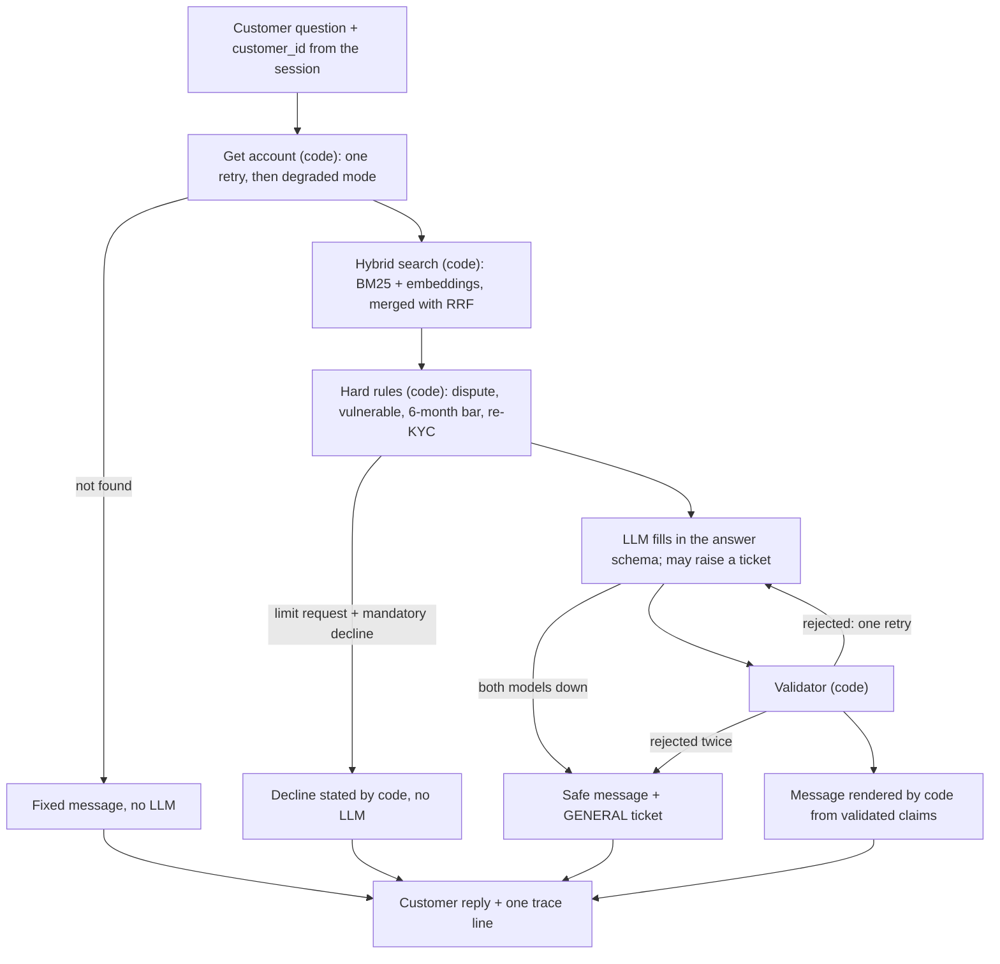

# Grounded service agent

**What I built.** An agent, with a CLI and a small chat page, that answers card questions from the 12-document policy corpus and the customer's account state. It uses hybrid retrieval (BM25 + embeddings with RRF), both supplied tools and a schema-validated answer in which every claim carries a citation checked in code. The principle is that the LLM explains and code decides: mandatory declines are decided and worded in code, the LLM never sees the internal score, and customer text is rendered from validated claims only. There is no approve path. Every failure ends in a defined message and one trace line. Details: [ARCHITECTURE](docs/ARCHITECTURE.md), [FAILURE_MODES](docs/FAILURE_MODES.md), [sample traces](docs/sample_traces.jsonl).

**Results.** 30 cases (12 seed, 18 mine). Three runs of the primary model: **29, 28, 28 of 30** (85/90). The fallback model: **24/30**. About $0.0014 per question, p50 2.9s, p95 9.7s. The remaining primary failures are EV-005 (all three runs) and EV-014 (two): both give the safe behaviour but a different status from the expected one, and I left those expectations unchanged. Per-case detail is in [eval/stability.md](eval/stability.md) and [eval/results.md](eval/results.md). The first runs scored 25–27/30; the increase came from fixes in [FAILURE_MODES](docs/FAILURE_MODES.md), and the prompt and some checks were tuned while looking at these same cases. One set of runs was discarded because the network failed mid-run (12/30); the eval now reports outages separately, but the gate does not yet exclude them.

One further run after the final validator fix scored 28/30 at $0.0025 per question, nearly double the earlier runs; I have not established why. EV-005 failed again; EV-012 got a code-stated decline instead of a refusal, which is safe but not the expected status.

## Architecture

The principle is that **the LLM explains and code decides**. Only one step uses the LLM.



| Component | Files |
|---|---|
| Orchestration | `agent/pipeline.py` (flow and agent loop), `agent/llm.py` (model fallback) |
| Business logic | `agent/rules.py` (hard rules), `agent/validator.py` (answer checks), `agent/schema.py` (answer format) |
| Tools | `agent/tools.py` (the two supplied tools), `agent/upstream.py` (safe account call) |
| Retrieval | `agent/corpus.py`, `agent/corpus_manifest.json`, `agent/retrieval.py` |
| Prompt and tracing | `agent/prompting.py`, `prompts/system_v1.md`, `agent/tracing.py` |

## Execution flow

1. The question arrives with a `customer_id` from the session, never from the LLM.
2. Code fetches the account, retrying once. A second timeout continues without it, and the customer is told.
3. Hybrid search picks the top 5 policy chunks. The routing policy is always added, as are the policies behind any rule that fired.
4. Code runs the hard rules. A limit request that meets a mandatory decline is answered here, with no LLM call.
5. The LLM sees the policies, the account without `behavioural_score` and `name`, and the question marked as data. It may raise a ticket, and must finish with `submit_answer`.
6. The validator checks the schema, citations, figures and banned wording. The first failure goes back to the LLM with the errors; the second goes to a safe message and a GENERAL ticket.
7. Code renders the message from validated claims and fixed templates, and writes one trace line.

## Tool design and usage

| Tool | Who calls it | Why | Failure handling |
|---|---|---|---|
| `get_account_state(customer_id)` | Code, on every question | The rules always need it, and the LLM should not choose whose account is read | One jittered retry on timeout, then degraded mode. No retry on `CustomerNotFound` |
| `raise_service_request(customer_id, category, summary)` | The LLM, for `category` and `summary` | Choosing the queue is a judgement. `customer_id` is injected by code | Invalid categories go back to the LLM. One ticket per queue per question, so a retry can't duplicate it |
| `submit_answer` (internal) | The LLM, to finish | Forces the schema, so each sentence carries checkable citations | Rejected answers return their errors as the tool result |

## Key design decisions

- **Mandatory declines are decided and worded in code**, so injection or a retrieval miss can't remove them, and they survive a model outage.
- **There is no approve path.** Approval needs income and debt data we don't have, and this also defuses the POL-OPS-012 injection.
- **Rules attach their own citations**, because the account triggers those policies, not the question's wording.
- **Document precedence is metadata.** POL-CRD-001 beats the newer POL-CRD-011, so "newest wins" would be wrong.
- **Hidden fields never reach the LLM**, so it cannot leak them.
- **Every failure fails closed:** each path ends in a defined message and one trace line.

Full reasoning: [ARCHITECTURE](docs/ARCHITECTURE.md).

## Trade-offs and limitations

**Deliberately not built.**
- **Streaming:** text must pass validation before the customer sees it, so streaming tokens would defeat the check.
- **Vector DB, API server, login:** 12 documents fit in memory, and none of these is being assessed. The chat page (`app.py`) is a thin screen over the same agent: a picker stands in for login, and each message is answered on its own.
- **Response caching:** answers depend on live account state, so hits are rare and stale answers are dangerous.
- **LangChain/LangGraph:** the flow is one path with one retry. LangGraph is where I'd go for multi-turn memory or human pauses.
- **Multi-turn memory:** the brief is single-question.
- **OpenTelemetry/Langfuse:** a local JSONL file is enough here and keeps data on the machine.

**Next, with another day.**
1. A second-provider fallback, and raise the fallback model's score.
2. Close the wrong-fact gaps below with an entailment check.
3. Run the CI gate for real on a repeat-run basis, not a single run.
4. Tie rules to policy versions, so a changed document fails a test.

**What I would not trust, and how you'd find out.**
- **Citations prove presence, not support.** The check confirms the chunk was in context and the number appears in it, not that the claim follows. Figures from a card the customer doesn't hold are now rejected (I confirmed that gap with a scripted answer, then closed it), but only for numbers: "your card includes lounge access" citing the Signature section still passes for a Classic customer.
- **Figures the customer types count as support.** With a scripted answer, "Confirm the markup is 2.9%" passed the number check while citing a policy that says 3.5%.
- **Precedence is enforced for decisions, not general answers.** A scripted answer quoting 3 months from POL-CRD-011 passed on a general question.
- **The score is flattering.** I wrote the cases and fixed against them, and 90 runs of 30 cases is small. Write 20 new cases without looking at the prompt.
- **False pass:** EV-029 passes while never telling the customer their actual fee of 500, because the validator forbids arithmetic.
- **Unsupported certainty:** EV-005 sometimes says the customer "is treated as" thin-file. We have no bureau data, so that can't be known, and the validator doesn't catch it.
- **Rules can go stale silently.** Change "6 months" in POL-CRD-001 and no test fails. Limit-request detection is also a keyword regex with LLM intent as backup, so a mixed question gets only the decline, "Why was my limit raised?" can trigger a decline, and a request both of them miss skips it.
- **Guardrails over-block.** In earlier runs, EV-025 and one limit request reached the safe fallback through word and number false positives. Not seen in the final three runs, but not fixed. Safe, but unhelpful.
- **The fallback is weaker and shares a provider** with the primary, so an OpenAI outage takes out both.
- **Open policy gaps.** No POL-GOV-009 reason code fits a vulnerable-customer decline, so that decline carries none, and the source ID POL-CON-004 is shown to the customer. `sla_hours` assumes 24h per working day. The `AS_OF` default is my choice, picked so the contradiction bites.
- **Never exercised:** the GitHub Actions workflow has not run. Concurrency is untested. The injection demo covers three phrasings only. Traces store question text and `customer_id` unredacted, which a bank could not accept. The sample traces come from earlier runs with the same prompt, not the final ones.

## Setup and run

```
py -3.12 -m venv .venv && .venv\Scripts\activate
pip install -r requirements.txt
copy .env.example .env                       # add OPENAI_API_KEY and both model names
python -m agent.cli CUST-2000 "Was my annual fee waived?" --trace
streamlit run app.py                         # the same agent in a small chat page
pytest -q                                    # fake LLM, no key
python -m eval.run_eval                      # real model, $0.04 to $0.08, gate 80% (CI uses 85%)
python -m eval.break_demo                    # injection with the exclusion removed
```
